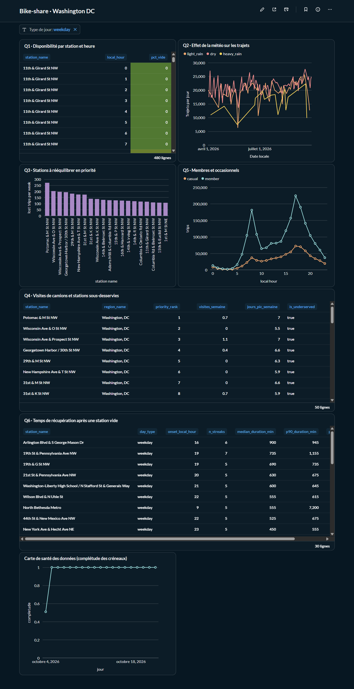
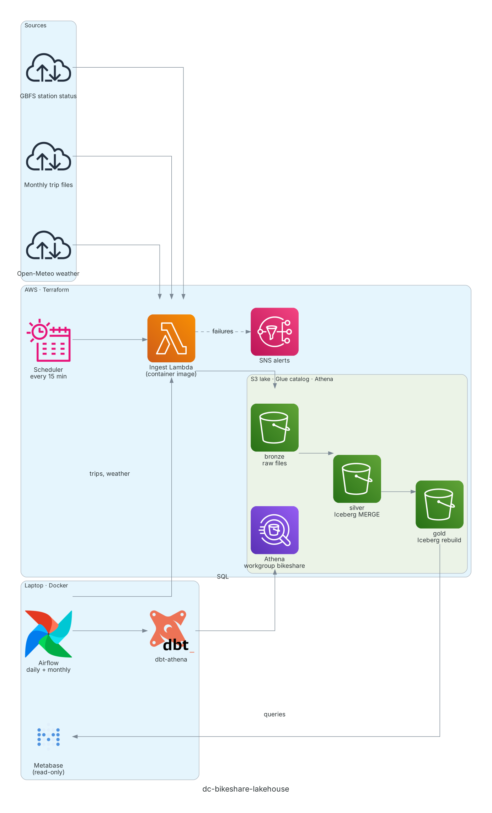

# dc-bikeshare-lakehouse

A batch data platform on AWS for Capital Bikeshare (Washington DC). It collects station availability every 15 minutes, monthly trip history and hourly weather, then answers operational questions: where riders find no bike or no dock, how many rides that costs, where rebalancing trucks should go, and how weather and rider type shape demand.



## Questions and findings

| # | Question | Gold table | Finding |
| --- | --- | --- | --- |
| Q1 | Where and when are stations empty or full? | `station_availability_profile` | Hour-by-hour profile per station and day type. At priority stations, empty episodes cluster between 8:00 and 13:00 on weekdays (14th & Belmont St NW is empty 73% of the time at 9:00). |
| Q2 | How much ridership do rain, heat and cold cost? | `weather_ridership_daily` | Heavy-rain days fall well below a normal day: 9,879 rides on 2026-09-22 against a baseline of 23,958. |
| Q3 | Which stations should be rebalanced first? | `station_rebalancing_priority` | The top 10 stations lose about 1,750 rides a week (lower bound), 89% of them to full docks. |
| Q4 | Where do trucks go, and which priority stations get too few visits? | `inferred_truck_visits`, `station_truck_summary` | 86 of 871 stations are flagged as underserved: in the top 10% of priority, but visited less often than they hit a peak. |
| Q5 | How do members and casual riders differ? | `rider_segments` | On weekdays, members peak at 8:00 and 17:00 (commuting); on weekends, both groups peak around 15:00. |
| Q6 | How long does a station stay empty once it empties? | `station_recovery` | Median recovery time per station, day type and hour of onset. |

Data: about 3.8 million rides (April to September 2026) and GBFS snapshots of 871 stations every 15 minutes since 2026-10-04.

## Architecture



The diagram is generated from [docs/architecture.py](docs/architecture.py).

- **Collection.** EventBridge Scheduler invokes a Lambda function every 15 minutes to save the GBFS station status. This runs in AWS, independently of the laptop, because a missed snapshot can never be fetched again.
- **Batch loads.** Local Airflow invokes the same Lambda for the monthly trip file and for weather, then runs dbt.
- **Transformation.** dbt sends SQL to Athena: bronze (raw files) → silver (cleaned Iceberg tables, MERGE on natural keys) → gold (KPI tables, rebuilt on each run).
- **Serving.** Metabase reads silver and gold through a read-only IAM user.
- **Alerting.** Invalid payloads go to `quarantine/`. Lambda errors, a stopped collection, Airflow failures, failed dbt tests and budget thresholds all send an email through one SNS topic.

## Stack

| Layer | Tools |
| --- | --- |
| Ingestion | AWS Lambda (container image), EventBridge Scheduler |
| Storage | Amazon S3 (bronze / silver / gold), Apache Iceberg, Parquet |
| Catalog and SQL | AWS Glue Data Catalog (partition projection), Amazon Athena (engine v3) |
| Transformation | dbt-core 1.12 with dbt-athena |
| Orchestration | Apache Airflow 3 (Astro CLI) |
| Infrastructure | Terraform |
| Observability | CloudWatch alarms, SNS, run log table, AWS Budgets |
| Dashboard | Metabase |
| CI | GitHub Actions, pre-commit (ruff, terraform fmt, gitleaks) |

## Data model

| Layer | Tables | Built by |
| --- | --- | --- |
| bronze | `gbfs_station_status`, `gbfs_station_information`, `trips`, `weather_raw` | Lambda; Glue tables defined in Terraform |
| silver | `dim_station`, `station_status`, `fct_trip`, `weather_hourly` | dbt, incremental Iceberg MERGE |
| gold | the seven tables listed under [Questions and findings](#questions-and-findings) | dbt, full rebuild |
| ops | `run_log` (one row per Lambda invocation) | Lambda |

Silver stores timestamps in UTC; gold converts them to Washington local time (`America/New_York`, DST-aware).

## Data quality and idempotency

- **At ingestion:** each payload is validated. A failing file goes to `quarantine/` and triggers an alert; it never reaches bronze.
- **In silver:** odd rows are kept and flagged (rides under 1 minute or over 24 hours, stale snapshots, dockless trips); gold filters on the flags.
- **dbt tests:** source freshness, `unique` and `not_null` on keys, value ranges, and cross-source checks: share of trips that match a station (100% measured on August 2026), share of the 96 daily slots collected, month-over-month trip counts.
- **Idempotency:** every run processes its own data interval, S3 keys derive from the scheduled time, and silver uses MERGE. The full backfill was run twice and gave identical row counts:

| Table | Rows, first run | Rows, second run |
| --- | --- | --- |
| `silver.fct_trip` | | |
| `silver.station_status` | | |
| `silver.weather_hourly` | | |
| `silver.dim_station` | | |

```sql
select 'fct_trip' as t, count(*) from silver.fct_trip
union all select 'station_status', count(*) from silver.station_status
union all select 'weather_hourly', count(*) from silver.weather_hourly
union all select 'dim_station', count(*) from silver.dim_station;
```

## Setup

Requires Linux or WSL2, Python 3.12, Docker, Terraform ≥ 1.6, AWS CLI v2, Astro CLI and pre-commit, plus an AWS account with an admin IAM user (MFA on) configured in the AWS CLI.

1. **Clone and install the git hooks**
   ```bash
   git clone https://github.com/Zineb550/dc-bikeshare-lakehouse.git
   cd dc-bikeshare-lakehouse
   make setup
   ```
2. **Configure Terraform**
   ```bash
   cp infra/terraform.tfvars.example infra/terraform.tfvars   # set alert_email
   make tf-init
   ```
3. **Create the image repository, then push the ingest image**
   ```bash
   make tf-apply-ecr
   make image-push
   ```
4. **Create everything else**
   ```bash
   make tf-plan     # review the plan
   make tf-apply
   ```
   Confirm the SNS subscription from the email AWS sends to `alert_email`.
5. **Check collection**
   ```bash
   make invoke-gbfs
   ```
   In Athena (workgroup `bikeshare`): `select count(*) from bronze.gbfs_station_status;`
6. **Start Airflow**
   ```bash
   aws iam create-access-key --user-name dc-bikeshare-airflow
   cp airflow/.env.example airflow/.env    # paste the key, bucket and topic ARN
   make airflow-start
   ```
   In the UI (http://localhost:8080), unpause `daily_pipeline` and `trips_monthly`. Both catch up from their start dates, one run at a time.
7. **Start Metabase** (stop Airflow first: both need RAM)
   ```bash
   aws iam create-access-key --user-name dc-bikeshare-metabase
   make metabase-start
   ```
   Place the Athena driver jar in `dashboards/plugins/` first (see the comments in `dashboards/docker-compose.metabase.yml`). In http://localhost:3000, add an Amazon Athena database: region `us-east-1`, workgroup `bikeshare`, S3 staging directory `s3://dc-bikeshare-lake-<account-id>/athena-results/`, and the `dc-bikeshare-metabase` key.

Access keys are always created with the AWS CLI, never by Terraform, so no secret lands in the Terraform state. `make help` lists every command.

## Operations

See [docs/runbook.md](docs/runbook.md): daily use, alert responses, key rotation, and the teardown and re-apply procedure (rehearsed once).

## Cost

About $1–2 a month. Lambda stays inside the free tier, S3 holds under 1 GB, and every Athena query is capped at 1 GB scanned. A $5 monthly budget emails at 50%, 80% and 100%. Details in [docs/cost.md](docs/cost.md).

## Design decisions

Each decision has a one-page record in [docs/adr/](docs/adr/README.md). The main trade-offs:

- **Collection outside Airflow** (ADR-0001): reliability of a live feed over a single orchestrator.
- **Iceberg MERGE in silver, full rebuild in gold** (ADR-0004, ADR-0005): idempotent incremental loads where data is large, simplicity where it is small.
- **Data-interval windows** (ADR-0006): reruns and backfills give the same result as the original run.
- **Local Airflow and Metabase** (ADR-0001, ADR-0010): $0 instead of managed services, at the cost of KPIs refreshing only when the laptop is on.

## Known limitations

- **No overlap yet between trips and snapshots.** Trip files run April–September; snapshots start in October. KPIs combining both join on station × day type × local hour until the October trip file lands in early November.
- **Q3 is a lower bound.** Demand observed while a station was empty is itself undercounted.
- **Q2 baseline is thin.** A "normal day" is the median of dry, mild days with the same weekday and month, which gives only 1 to 4 days per baseline. Treat Q2 as a trend, not an exact count of lost rides.
- **Inferred truck visits are a heuristic** (a jump in bikes that riders alone cannot explain) until validated against overlapping trips.
- **Q6 is still sparse**: recovery streaks need several weeks of snapshots.
- **One weather point** for the whole system (an ERA5 cell of about 25 km covers the service area).
- **Stations are type 1**: renames and capacity changes are not historized.
- **Daylight saving time**: on 2026-11-01, the hour 01:00–02:00 repeats; rides in that hour use the first offset.
- **Airflow and Metabase run locally**: KPIs refresh only when the laptop is on; collection never stops.

## Repository layout

```
infra/                  Terraform (one file per concern, local state)
ingestion/              Lambda package: gbfs, trips and weather handlers, tests
airflow/dags/           daily_pipeline, trips_monthly
airflow/include/        dbt runner, run log, alerts
airflow/dbt/            dbt project: staging, silver, gold, tests, macros
dashboards/             Metabase compose file and screenshots
docs/                   architecture diagram, ADRs, cost, runbook
```

## Data sources and attribution

- **Capital Bikeshare** trip history and GBFS real-time feeds, used under the [Capital Bikeshare Data License Agreement](https://capitalbikeshare.com/data-license-agreement). This repository contains code only, no data files.
- **Weather data** by [Open-Meteo.com](https://open-meteo.com/), licensed under [CC BY 4.0](https://creativecommons.org/licenses/by/4.0/).

## License

[MIT](LICENSE)
